# DATABASE — PostgreSQL 17 + Prisma 7

Nguồn sự thật: `packages/database/prisma/schema.prisma` + các migration SQL có version trong `packages/database/prisma/migrations/`. ERD và bảng thống kê ở cuối file được **sinh tự động** từ schema (`pnpm docs:erd`) nên không thể lệch.

## Migration

| Migration | Nội dung |
|---|---|
| `20261010000000_init` | toàn bộ bảng, enum, index, khoá ngoại |
| `20261010000100_constraints` | CHECK (độ dài, trạng thái hợp lệ, `ACTIVE ⇒ có passwordHash`, `PENDING_RESET ⇒ không có hash`, `PUBLISHED ⇒ có publishedAt`, lý do bắt buộc khi từ chối/yêu cầu sửa…), chỉ mục trigram GIN cho tìm kiếm, **audit_logs bất biến** (trigger chặn UPDATE/DELETE/TRUNCATE + thu hồi quyền), `review_events` bất biến, trigger ánh xạ tỉnh 63→34 và tỉnh gốc của học viên |
| `20261010000200_contact_receipt_seq` | sequence cấp mã tiếp nhận liên hệ (`LH-2026-000123`) |
| `20261010000300_redirect_query_unique` | duy nhất theo `(fromPath, COALESCE(fromQuery,''))` để chứa nhiều `/?p=ID` |

`pnpm db:migrate` = `prisma migrate deploy` (chỉ áp migration đã có, không sinh mới). Mọi thay đổi schema sau này: sửa `schema.prisma` → `pnpm db:migrate:dev` → commit cả thư mục migration.

## Vai trò (least privilege)

| Role | Quyền | Dùng bởi |
|---|---|---|
| `postgres` | superuser | chỉ tạo DB/role lần đầu, restore |
| `hbvl_migrator` | sở hữu schema, DDL | `migrate deploy`, seed tham chiếu, CLI migration WordPress, bootstrap admin |
| `hbvl_app` | **chỉ DML** trên bảng do migrator sở hữu; **không** UPDATE/DELETE `audit_logs`/`review_events` | API + worker khi chạy |

Ứng dụng đang chạy không có quyền DDL; ngay cả khi có lỗ hổng SQL injection, kẻ tấn công không thể `DROP`/sửa nhật ký kiểm toán.

## Nguyên tắc mô hình

- **Tài khoản ≠ học viên**: `users` và `scholarship_members` tách biệt; liên kết `userId` là tuỳ chọn, tường minh, **không bao giờ** khớp theo tên.
- **Trạng thái bài**: `DRAFT → PENDING_REVIEW → {CHANGES_REQUESTED, REJECTED, PUBLISHED}`; `SCHEDULED/PRIVATE/TRASHED` dành cho nội dung WP/admin. Kiểm bằng state machine thuần (`apps/api/src/posts/state-machine.ts`) **và** CHECK ở DB.
- **Đồng thời lạc quan**: `posts.version` + `If-Match`/ETag; cập nhật dạng `UPDATE … WHERE version = $n` (0 dòng ⇒ 409).
- **Idempotency**: `idempotency_records` — duy nhất theo `(actorId, operation, key)`, kèm `requestHash` (cùng key khác payload ⇒ 422); chèn `ON CONFLICT DO NOTHING` trong cùng transaction với thao tác.
- **Outbox**: `outbox_events` ghi cùng transaction nghiệp vụ; worker `FOR UPDATE SKIP LOCKED` → BullMQ; payload e-mail mã hoá và bị xoá sau khi gửi.
- **Media**: `media_assets` mặc định `PRIVATE`; chỉ chuyển `PUBLIC` khi bài chứa nó được xuất bản; khoá object do server sinh (không dùng tên tệp của người dùng).
- **Tìm kiếm tiếng Việt**: cột `searchText` đã bỏ dấu (`đ→d`, lowercase) + GIN trigram; truy vấn cũng được bỏ dấu cùng hàm `foldVietnamese`.
- **Lượt thích cũ**: `posts.legacyLikeCount` giữ tổng số WP (không có danh sách người thích); `likeCount` = số tài khoản thực.
- **Tỉnh/thành**: `provinces(system CURRENT_34|LEGACY_63)`; mã `p11…` của theme **không** phải mã hành chính (`officialCode` riêng, chỉ có cho 34 đơn vị hiện hành); Hoàng Sa/Trường Sa không phải tỉnh.
- **Truy vết migration**: `legacy_id_map(source, legacyType, legacyId) → entity` + checksum nguồn/đích; `migration_runs`, `migration_issues` (không chứa e-mail/mật khẩu/nội dung thư).

## Dữ liệu cá nhân & lưu giữ

| Dữ liệu | Nơi | Lưu giữ / xử lý |
|---|---|---|
| e-mail, tên hiển thị, hash mật khẩu Argon2id | `users` | xoá tài khoản = **ẩn danh hoá** (`DELETED`), giữ bài/bình luận không tên |
| secret MFA | `users.mfaSecretEnc` | AES-256-GCM; mã khôi phục lưu hash |
| phiên | `sessions` | lưu **hash** token; hết hạn tuyệt đối + trượt; dọn bởi worker bảo trì |
| IP | chỉ `ipHash` (HMAC-SHA256 với `TOKEN_HASH_PEPPER`, cắt 16 ký tự) trong `sessions`/`audit_logs` | không lưu IP thô |
| nội dung góp ý/liên hệ | `feedbacks`, `contact_messages` | chỉ CTV+admin / admin đọc |
| nhật ký kiểm toán | `audit_logs` | append-only, lọc: không mật khẩu/token/nội dung thư |

## Sao lưu / khôi phục
Xem `docs/OPERATIONS.md` (`pnpm ops backup|restore|verify|drill`) — gồm kiểm tra bộ đếm từng bảng, checksum từng object và sự tồn tại của trigger bất biến sau khi khôi phục.

## ERD và thống kê bảng (tự sinh)

<!-- ERD:BEGIN (generated by scripts/docs/gen-erd.mjs — do not edit by hand) -->

40 models, 41 foreign-key relations, 30 enums.

```mermaid
erDiagram
  User ||--o{ UserProfile : "user"
  User ||--o{ Session : "user"
  User ||--o{ AuthToken : "user"
  User ||--o{ MfaRecoveryCode : "user"
  Category |o--o{ Category : "parent"
  Category ||--o{ CategoryTranslation : "category"
  User |o--o{ Post : "author"
  MediaAsset |o--o{ Post : "featured"
  Post ||--o{ PostTranslation : "post"
  Post ||--o{ PostCategory : "post"
  Category ||--o{ PostCategory : "category"
  Post ||--o{ PostTag : "post"
  Tag ||--o{ PostTag : "tag"
  Post ||--o{ EventDetail : "post"
  Post ||--o{ ProgramDetail : "post"
  Post ||--o{ PostRevision : "post"
  Post ||--o{ ReviewEvent : "post"
  User |o--o{ ReviewEvent : "actor"
  Page |o--o{ Page : "parent"
  Page ||--o{ PageTranslation : "page"
  User |o--o{ MediaAsset : "owner"
  Post ||--o{ PostMedia : "post"
  MediaAsset ||--o{ PostMedia : "asset"
  Post ||--o{ Comment : "post"
  User |o--o{ Comment : "author"
  Comment |o--o{ Comment : "parent"
  User ||--o{ PostLike : "user"
  Post ||--o{ PostLike : "post"
  User |o--o{ Feedback : "author"
  Feedback ||--o{ FeedbackStatusHistory : "feedback"
  User |o--o{ ContactMessage : "user"
  ContactMessage ||--o{ ContactStatusHistory : "contact"
  User ||--o{ Notification : "user"
  OutboxEvent ||--o{ EmailDeliveryAttempt : "outboxEvent"
  MediaAsset |o--o{ Province : "photo"
  Province ||--o{ ProvinceMapping : "legacy"
  Province ||--o{ ProvinceMapping : "current"
  Province ||--o{ ScholarshipMember : "legacyProvince"
  User |o--o{ ScholarshipMember : "user"
  Province ||--o{ DirectoryContact : "province"
  MigrationRun ||--o{ MigrationIssue : "run"
  User {
    string id PK
    string username
    string usernameNormalized UK
    string email
    string emailNormalized UK
    string displayName
    string passwordHash
    enum role
    enum status
    datetime emailVerifiedAt
    enum locale
    boolean mfaEnabled
    string mfaSecretEnc
    datetime lastLoginAt
    int failedLoginCount
    datetime lockedUntil
    datetime createdAt
    datetime updatedAt
    datetime deletedAt
  }
  UserProfile {
    string userId PK
    string bio
    json notificationPrefs
    datetime updatedAt
  }
  Session {
    string id PK
    string userId
    string tokenHash UK
    string csrfSalt
    datetime createdAt
    datetime lastSeenAt
    datetime expiresAt
    datetime idleExpiresAt
    boolean rememberMe
    datetime mfaVerifiedAt
    string ipHash
    string userAgent
    datetime revokedAt
  }
  AuthToken {
    string id PK
    string userId
    enum purpose
    string tokenHash UK
    datetime expiresAt
    datetime usedAt
    datetime createdAt
  }
  MfaRecoveryCode {
    string id PK
    string userId
    string codeHash
    datetime usedAt
    datetime createdAt
  }
  Category {
    string id PK
    string slug UK
    string parentId
    int sortOrder
    enum cardType
    string iconKey
    boolean isSystem
    datetime createdAt
    datetime updatedAt
  }
  CategoryTranslation {
    string categoryId
    enum locale
    string name
    string navLabel
    string summary
    string description
  }
  Tag {
    string id PK
    string slug UK
    string name
  }
  Post {
    string id PK
    enum kind
    string slug
    string authorId
    enum status
    string title
    string excerpt
    string contentHtml
    string contentText
    string searchText
    string featuredAssetId
    datetime publishedAt
    datetime scheduledAt
    datetime submittedAt
    int version
    boolean commentsOpen
    int likeCount
    int legacyLikeCount
    enum origin
    boolean needsReview
    enum originalLocale
    datetime createdAt
    datetime updatedAt
    datetime deletedAt
  }
  PostTranslation {
    string postId
    enum locale
    string title
    string excerpt
    string contentHtml
    string contentText
    string searchText
    datetime updatedAt
  }
  PostCategory {
    string postId
    string categoryId
    boolean isPrimary
  }
  PostTag {
    string postId
    string tagId
  }
  EventDetail {
    string postId PK
    datetime startsAt
    datetime endsAt
    string locationText
  }
  ProgramDetail {
    string postId PK
    datetime openFrom
    datetime openUntil
    string applyUrl
  }
  PostRevision {
    string id PK
    string postId
    int version
    enum kind
    string actorId
    string title
    string contentHtml
    string_array categoryIds
    datetime createdAt
  }
  ReviewEvent {
    string id PK
    string postId
    string actorId
    enum action
    enum fromStatus
    enum toStatus
    string reason
    int postVersion
    datetime createdAt
  }
  Page {
    string id PK
    string parentId
    string slug
    enum status
    enum template
    int sortOrder
    string title
    string contentHtml
    string contentText
    string searchText
    datetime publishedAt
    int version
    enum origin
    boolean needsReview
    datetime createdAt
    datetime updatedAt
    datetime deletedAt
  }
  PageTranslation {
    string pageId
    enum locale
    string title
    string contentHtml
    string contentText
    datetime updatedAt
  }
  MediaAsset {
    string id PK
    string ownerId
    enum status
    enum visibility
    enum purpose
    string bucket
    string objectKey
    string mime
    int byteSize
    int width
    int height
    string checksumSha256
    string originalName
    json variants
    boolean isPlaceholder
    datetime createdAt
    datetime attachedAt
    datetime deletedAt
  }
  PostMedia {
    string postId
    string assetId
    enum role
    int sortOrder
  }
  Comment {
    string id PK
    string postId
    string authorId
    string authorName
    string parentId
    int depth
    string body
    enum status
    string moderatedById
    datetime createdAt
    datetime updatedAt
  }
  PostLike {
    string userId
    string postId
    datetime createdAt
  }
  Feedback {
    string id PK
    string authorId
    string subject
    string message
    enum status
    datetime createdAt
    datetime updatedAt
    enum origin
  }
  FeedbackStatusHistory {
    string id PK
    string feedbackId
    string actorId
    enum fromStatus
    enum toStatus
    string note
    datetime createdAt
  }
  ContactMessage {
    string id PK
    string receiptCode UK
    string userId
    string name
    string email
    string subject
    string message
    enum status
    enum mailState
    string mailError
    enum origin
    datetime createdAt
    datetime updatedAt
  }
  ContactStatusHistory {
    string id PK
    string contactId
    string actorId
    enum fromStatus
    enum toStatus
    datetime createdAt
  }
  Notification {
    string id PK
    string userId
    string type
    string title
    string body
    json data
    datetime readAt
    datetime createdAt
  }
  OutboxEvent {
    string id PK
    string type
    string aggregateType
    string aggregateId
    json payload
    string dedupeKey UK
    enum status
    int attempts
    datetime availableAt
    datetime lockedAt
    string lastError
    datetime createdAt
    datetime processedAt
  }
  EmailDeliveryAttempt {
    string id PK
    string outboxEventId
    int attempt
    enum state
    string providerResponse
    string messageId
    datetime createdAt
  }
  IdempotencyRecord {
    string id PK
    string actorId
    string operation
    string key
    string requestHash
    enum status
    int responseStatus
    json responseBody
    string resourceId
    datetime createdAt
    datetime expiresAt
  }
  AuditLog {
    bigint id PK
    datetime at
    string actorId
    enum actorRole
    string action
    string resourceType
    string resourceId
    enum result
    string requestId
    string ipHash
    json metadata
  }
  SiteSetting {
    string key PK
    json value
    string updatedById
    datetime updatedAt
  }
  Redirect {
    string id PK
    string fromPath
    string fromQuery
    string toPath
    int statusCode
    enum source
    datetime createdAt
  }
  Province {
    string id PK
    enum system
    string code
    string officialCode
    string nameVi
    string nameEn
    string slug
    enum kind
    string photoAssetId
    int sortOrder
  }
  ProvinceMapping {
    string legacyProvinceId PK
    string currentProvinceId
  }
  ScholarshipMember {
    string id PK
    string fullName
    string normalizedName
    string legacyProvinceId
    string sourceIdentity UK
    string userId UK
    enum status
    boolean isPublic
    string importRunId
    datetime createdAt
    datetime updatedAt
  }
  DirectoryContact {
    string id PK
    string provinceId
    string name
    string role
    string contactPath
    enum verification
    string source
    int sortOrder
  }
  LegacyIdMap {
    string id PK
    string source
    string legacyType
    string legacyId
    string entityType
    string entityId
    string sourceChecksum
    string importedChecksum
    datetime migratedAt
  }
  MigrationRun {
    string id PK
    enum mode
    enum status
    string fingerprint
    datetime startedAt
    datetime finishedAt
    json stats
    json checkpoint
  }
  MigrationIssue {
    string id PK
    string runId
    enum severity
    string code
    string legacyType
    string legacyId
    string message
    json detail
    datetime createdAt
  }
```

| Model | Table | Columns | Foreign keys |
|---|---|---:|---:|
| User | `users` | 19 | 0 |
| UserProfile | `user_profiles` | 4 | 1 |
| Session | `sessions` | 13 | 1 |
| AuthToken | `auth_tokens` | 7 | 1 |
| MfaRecoveryCode | `mfa_recovery_codes` | 5 | 1 |
| Category | `categories` | 9 | 1 |
| CategoryTranslation | `category_translations` | 6 | 1 |
| Tag | `tags` | 3 | 0 |
| Post | `posts` | 24 | 2 |
| PostTranslation | `post_translations` | 8 | 1 |
| PostCategory | `post_categories` | 3 | 2 |
| PostTag | `post_tags` | 2 | 2 |
| EventDetail | `event_details` | 4 | 1 |
| ProgramDetail | `program_details` | 4 | 1 |
| PostRevision | `post_revisions` | 9 | 1 |
| ReviewEvent | `review_events` | 9 | 2 |
| Page | `pages` | 17 | 1 |
| PageTranslation | `page_translations` | 6 | 1 |
| MediaAsset | `media_assets` | 18 | 1 |
| PostMedia | `post_media` | 4 | 2 |
| Comment | `comments` | 11 | 3 |
| PostLike | `post_likes` | 3 | 2 |
| Feedback | `feedbacks` | 8 | 1 |
| FeedbackStatusHistory | `feedback_status_history` | 7 | 1 |
| ContactMessage | `contact_messages` | 13 | 1 |
| ContactStatusHistory | `contact_status_history` | 6 | 1 |
| Notification | `notifications` | 8 | 1 |
| OutboxEvent | `outbox_events` | 13 | 0 |
| EmailDeliveryAttempt | `email_delivery_attempts` | 7 | 1 |
| IdempotencyRecord | `idempotency_records` | 11 | 0 |
| AuditLog | `audit_logs` | 11 | 0 |
| SiteSetting | `site_settings` | 4 | 0 |
| Redirect | `redirects` | 7 | 0 |
| Province | `provinces` | 10 | 1 |
| ProvinceMapping | `province_mappings` | 2 | 2 |
| ScholarshipMember | `scholarship_members` | 11 | 2 |
| DirectoryContact | `directory_contacts` | 8 | 1 |
| LegacyIdMap | `legacy_id_map` | 9 | 0 |
| MigrationRun | `migration_runs` | 8 | 0 |
| MigrationIssue | `migration_issues` | 9 | 1 |

<!-- ERD:END -->
